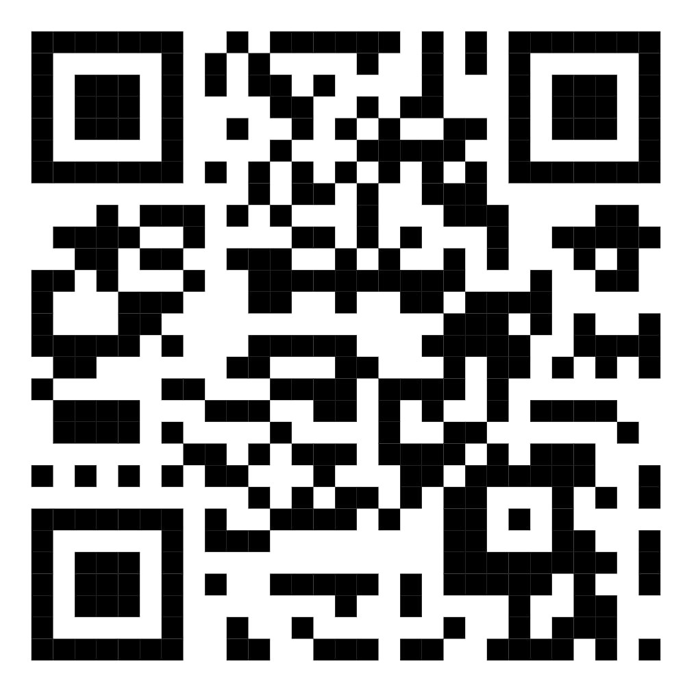
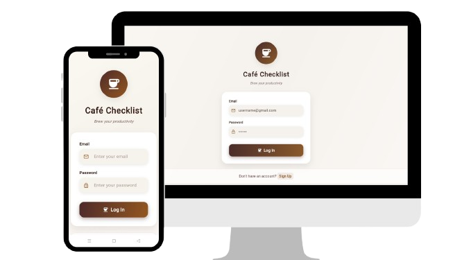

# ☕ Cafe Checklist

### Brew Your Productivity, One Task at a Time ☕

**A smart task management application designed to help users organize daily activities, track progress, collaborate with others, and improve productivity through visual task management.**

 

[📌 Overview](#overview) ·
[✨ Features](#features) ·
[📅 Calendar](#calendar) ·
[👥 Group](#group) ·
[📊 Personal](#personal) ·
[🛠️ Technologies](#technologies)

---

Scan the QR code below and start brewing your productivity journey!

 

 

✨ **Scan Me!** ✨

 

_Your daily tasks are just one scan away ☕_

# 📌 Overview

Cafe Checklist is a productivity management application designed to help users organize, track, and complete their daily tasks more effectively.

Unlike a traditional checklist application, Cafe Checklist provides a structured task management system by separating tasks into different stages, including Today, Long Term, History, and Calendar views.

The system helps users understand their task progress through visual indicators, automatic status updates, and personal productivity analysis.

 

# 📱 Web Application Interface
 

 

# ✨ Features

Cafe Checklist provides different task views to help users manage tasks based on urgency and completion status.

### Today Tasks

- Displays tasks that require immediate attention
- Automatically removes completed tasks from the active list
- Helps users focus on daily priorities

### Long Term Tasks

Designed for tasks with future deadlines.

Features:
- Supports both automatic and manual colour management
- Automatically updates task status based on approaching deadlines
- Allows users to manually customize task colours when needed
- Completed tasks are removed from the active interface

### History Tracking

Keeps track of previously completed tasks.

Features:
- Stores completed and overdue tasks
- Differentiates task completion status:
  - ✅ Done: Completed before the due date
  - ⚠️ Done Late: Completed after the due date
  - ⏳ Pending: Task is incomplete

 

# 📅 Calendar-Based Progress Tracking

The calendar provides users with a visual overview of their productivity.

Features:

⭐ Completion Indicator
- A star is displayed when all tasks scheduled for a specific day are completed

🎨 Task Status Visualization
- Task colours represent different progress states
- Automatically generated task colours update according to deadlines
- Manually assigned colours remain unchanged unless modified by the user

 

# 👥 Group Task Collaboration

Cafe Checklist supports collaborative task management for group activities.

Features:

- Users who create a group become the group owner
- Only the owner can add or remove members
- Both owners and members can assign tasks
- Task editing permissions are controlled based on ownership

 

# 📊 Personal Productivity Analysis

The Personal section provides users with insights into their task performance.

Features:

- Records completed and pending tasks across:
  - Today
  - Long Term
  - History

- Provides productivity visualization using:

📊 Bar Chart
- Displays the number of completed tasks on each day
- Helps users analyze their productivity trends

 

# 🛠️ Technologies Used

(Add your technologies here)

Example:

- Flutter
- Firebase Authentication
- Cloud Firestore
- Dart

 

# 👨‍💻 Contributors

- **Chai Shun Ying**
- **Ng Yu Hui**
